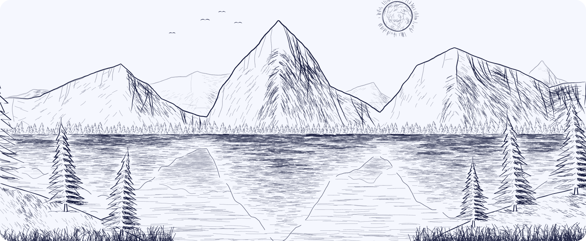
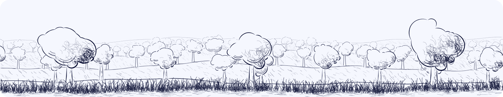

<picture>
  <source media="(prefers-color-scheme: dark)" srcset="assets/banner-dark.png">
  
</picture>

<a href="https://e-portfolio.linustabanao.workers.dev">
  <picture>
    <source media="(prefers-color-scheme: dark)" srcset="https://readme-typing-svg.demolab.com?font=JetBrains+Mono&weight=600&size=26&duration=3200&pause=1400&color=00FFC3&center=true&vCenter=true&width=700&height=70&lines=Hi%2C+I%27m+Linus;Information+Systems+Student;Web+Developer;UI%2FUX+Designer;Systems+Thinker">
    
  </picture>
</a>

**Systems-oriented developer bridging technical depth with user-centered design.** 
I build efficient, scalable digital solutions, from Java MVC systems and Node.js back offices to Figma prototypes.

## About

- **Studying:** BS Information Systems at De La Salle University (expected 2028)
- **Based in:** Makati City, Philippines
- **Currently:** building school information systems and mobile and web apps, and digging into network programming with Python
- **Also design:** UX research, Figma prototypes, and HCI-driven redesigns
- **Results:** redesigned a school website and grew its daily traffic about 6× (roughly 30 to 180+ daily users)
- **Open to:** internships, freelance projects, and full-time roles

## Tech stack

**Languages** 
<picture>
  <source media="(prefers-color-scheme: dark)" srcset="https://skillicons.dev/icons?i=java,c,cpp,py,js,ts,html,css&theme=dark">
  
</picture>

**Frameworks, data and tools** 
<picture>
  <source media="(prefers-color-scheme: dark)" srcset="https://skillicons.dev/icons?i=react,nodejs,express,django,mysql,vite,cloudflare,git,github,vscode&theme=dark">
  
</picture>

**Design and media** 
<picture>
  <source media="(prefers-color-scheme: dark)" srcset="https://skillicons.dev/icons?i=figma,ps,pr&theme=dark">
  
</picture>

Also: MVC architecture, OOP, REST APIs, Canva, Procreate, SEO awareness, systems analysis.

## Projects

| Project | What it is | Stack |
| --- | --- | --- |
| [ITISDEV-Grp4](https://github.com/Eniloan4002/ITISDEV-Grp4) | Restaurant management information system for AM Restaurant: a public landing page plus a role-gated back office for inventory, point of sale, attendance and reservations (team project). | Node.js, MySQL |
| [ISANDE1-Grp7](https://github.com/Eniloan4002/ISANDE1-Grp7) | ICI Local 2.0, a school information system that brings applicant intake, student records, enrollment management and academic monitoring into one app (team project). | Java, JavaScript, Supabase |
| [ici-dependency-board](https://github.com/Eniloan4002/ici-dependency-board) | Interactive dependency and sprint board with shared, live-synced progress, [running here](https://eniloan4002.github.io/ici-dependency-board/). | HTML, JavaScript, Firebase |
| [ITISMOB-DailyAnchor](https://github.com/Eniloan4002/ITISMOB-DailyAnchor) | Android mobile app project built with Java. | Java, Android |
| [T1AY2526-CSNETWK-MP](https://github.com/Eniloan4002/T1AY2526-CSNETWK-MP) | Computer networks machine project using Python sockets. | Python |

More case studies live on my [portfolio](https://e-portfolio.linustabanao.workers.dev): a Java convenience store system in MVC, a DLSU enrollment system redesign in Figma, and two research papers on business intelligence and systems thinking.

## GitHub stats

  <picture>
    <source media="(prefers-color-scheme: dark)" srcset="https://github-readme-stats.vercel.app/api?username=Eniloan4002&show_icons=true&hide_border=true&hide_rank=true&custom_title=GitHub+Stats&bg_color=00000000&title_color=00FFC3&text_color=C9D1D9&icon_color=0096FF">
    
  </picture>
  <picture>
    <source media="(prefers-color-scheme: dark)" srcset="https://github-readme-stats.vercel.app/api/top-langs/?username=Eniloan4002&layout=compact&langs_count=6&hide_border=true&bg_color=00000000&title_color=00FFC3&text_color=C9D1D9">
    
  </picture>

  <picture>
    <source media="(prefers-color-scheme: dark)" srcset="https://raw.githubusercontent.com/Eniloan4002/Eniloan4002/output/github-snake-dark.svg">
    
  </picture>

## Latest from the blog

<!-- BLOG-POSTS:START -->
_Nothing published yet. Visit the [blog](https://e-portfolio.linustabanao.workers.dev/blog) soon._
<!-- BLOG-POSTS:END -->

<i>"I try to make more than I do take."</i>

<picture>
  <source media="(prefers-color-scheme: dark)" srcset="assets/footer-dark.png">
  
</picture>

